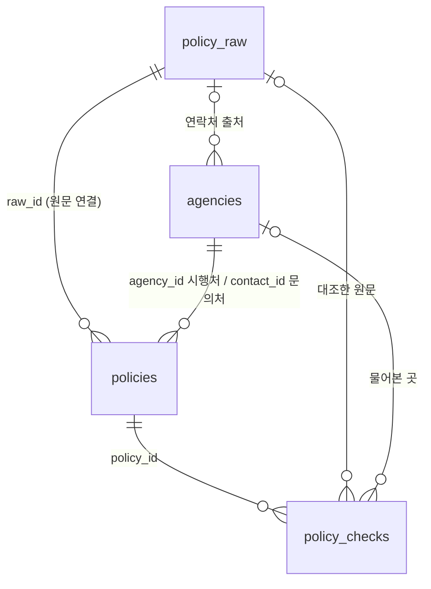

# Perky DB 재설계 — 핵심 5테이블

작성일: 2026-11-09
바탕: `Perky_DB_summary.docx`(11/3)의 표 22개 + 11/3 정일혁 멘토링

| 파일 | 내용 |
|---|---|
| `supabase/migrations/20261110000000_perky_5tables.sql` | 표 4개 · 규칙 · 정책 고르기(`match_policies`) · 권한 (11/11 확정 반영) |
| `supabase/tests/redesign.test.mjs` | 위 SQL 을 실제 Postgres(PGlite)에 적용해 확인하는 검사 **51개 — 전부 통과** |

```bash
cd supabase/tests
node redesign.test.mjs      # 처음이면 npm install 먼저
```

> [!IMPORTANT]
> **11/11 확정 — 이 문서는 "표 설계 설명"이다. 할 일과 금지 사항은 [2026-11-11-DB-익산-원문검수-계획.md](2026-11-11-DB-익산-원문검수-계획.md)를 따른다.**
> - 앱은 지금처럼 정책 JSON 을 읽는다. Supabase 는 **익산 14건 + 새 후보 2건의 원문·검수 기록**만 담는다
> - **① 사용자 조건 표는 SQL 에서 뺐다.** 사용자 데이터는 AWS(`infra/` DynamoDB `UserData`, 카카오 로그인)가 맡는다.
>   멘토의 "사용자 테이블"은 AWS 쪽, 나머지 정책 쪽 4개(②~⑤)가 Supabase 다. 아래 ① 관련 내용은 설계 당시 기록으로 남겨 둔다
> - **익명(anon) 접근은 전부 막았다.** 앱이 이 DB 를 읽지 않고, 내부 메모(`notes`)가 밖으로 나가면 안 되기 때문이다
> - 원문 종류의 복지로를 **지자체 / 중앙부처**로 나눴다
> - **DB → JSON 내보내기는 하지 않는다.** 옛 설계(11/2, 표 11개) 파일은 지웠다
> - 숫자 갱신: 최신 `develop`(익산 12건 재대조·신규 3건) 기준 전국·전북·익산 **14건**이 들어간다. 아래 본문의 11건·51행 등은 11/9 데이터 기준이다

---

## 1. 한눈에

멘토 조언: **"필수 테이블 4개(사용자·정책 원문·가공 정책·기타 정보), 익산시 기준 5개를 넘기지 말 것, 과도한 조인 금지."**

| # | 표 | 한 행 = | 멘토 표 | docx에서 합친 표 |
|---|---|---|---|---|
| ① | ~~`user_conditions` 사용자 조건~~ → **AWS `UserData`가 맡음 (11/11)** | 사용자 한 명의 답 | 사용자 | (리서치의 응답자 조건과 같은 칸) |
| ② | `policy_raw` 정책 원문 | 한 번 가져온 원문 (API JSON·공고문·전화 답변) | 정책 원문 | 출처 · 외부 시스템 ID |
| ③ | `policies` 가공 정책 | 정책 하나의 한 회차 | 가공 정책 | 정책 · 정책 조건(연도별) · 정책-지역 연결 |
| ④ | `agencies` 시행처·연락처 | 기관의 창구 하나 | 기타 정보 | 기관 · 연락처 · 정책-연락처 연결 |
| ⑤ | `policy_checks` 확인 기록 | 확인 한 번 | (신뢰도) | 검수 기록 · 미확인 질문 |



- 사용자 조건으로 정책을 고를 때 읽는 표는 **③ 하나**이고, 문의처 이름을 붙이려고 **④를 한 번** 본다.
- ②·⑤는 화면에 나가지 않는 팀 기록이다.
- ⑤가 쌓이면 ③의 **정책 확인일**과 **신뢰도 등급**이 자동으로 바뀐다.

---

## 2. 멘토가 말한 것 → 어디서 해결했나

| 멘토 요구 | 해결한 곳 |
|---|---|
| 필수 4개 + 5개 이하 | ①~④ + 확인 기록 ⑤ = 5개 |
| 원문은 API JSON 을 키-밸류 그대로, 출처 기록 | ② `payload`(jsonb 그대로) · `kind`·`url`·`retrieved_at` |
| 가공 정책은 조건값만, 원문과 PK 로 연결 | ③ `raw_id` → ② `id` |
| 정책 번호 · 원문 주소 · 대상 나이 · 급여 수준 · 주거 형태 | ③ `policy_no` · `source_url` · `age_min/max` · `income_*` · `housing_types` |
| 정책 유효 기간 (예: 2026.10~2026.12) | ③ `valid_from` · `valid_until` (신청 기간 `apply_*`과 따로) |
| 정책 확인일 (매일 밤 12시 확인) | ⑤에 `자동확인` 기록 → ③ `checked_at` 자동 갱신 (7장) |
| 원문 사이트 · 상담 전화 함께 표시 | ③ `source_url` + ④ `phone` → `match_policies` 결과의 `contact` |
| 사용자 조건에 맞춰 Select | `match_policies()` (6장) |
| 하드 필터링, 결과가 안 맞으면 솔직하게 | 나이·지역·상태·소득·주거 5개를 통과/불일치/모름으로 판정 |
| 세전·세후 구분 | ①·③ `income_basis` |
| 군 복무 2년 가산 | ① `military_service` + ③ `age_military_extension` |
| 평형 제한 (60㎡ 이하) | ③ `area_max_m2` |
| "5개 중 4개 충족, 1개 확인 필요" | 결과의 `pass_count` · `unknown_count` |
| "한 번 더 확인해 보면 좋은 지원금" | 결과의 `near_miss` (지역 말고 하나만 안 맞음) |
| "이미 끝난 지원금" | 결과의 `apply_state = '마감'` |
| 누적 이용자 수 (체류 시간 대신) | AWS `UserData` 쪽에서 센다 (11/11, 사용자 표는 Supabase 에 두지 않음) |
| 익산시청 직접 문의 | ② `kind='전화'` (질문·답변 원문) + ⑤ `method='전화문의'` |
| GPT·Claude 교차 검증 | ⑤ `method='AI교차'` — 기록은 남지만 **신뢰도 등급에는 안 들어간다** (AI 는 검증용이 아니라는 조언) |

---

## 3. docx 표 22개는 어디로 갔나

| docx 영역 | docx 표 | 새 설계 |
|---|---|---|
| ① 지역 | 지역 `regions` | **표 없이 코드 규칙으로.** 행정구역코드 앞 2자리가 시도라서 `52140`(익산) → `52`(전북) → `00`(전국)으로 상속된다 |
| | 지역 통계 `region_stats` | **뺌.** 평균 월세 같은 통계는 발표 자료로 |
| ② 정책 | 정책 `policies` + 정책 조건 `policy_versions` | ③ `policies` 하나로. 한 행 = 정책 × 회차, `is_current`로 지금 회차 표시. 공고가 바뀌면 새 회차 행 추가 (docx의 "덮어쓰지 않고 새 행" 그대로) |
| | 정책-지역 연결 `policy_regions` | ③ `region_codes` 배열 |
| | 외부 시스템 ID `policy_external_ids` | ② `external_id` (온통청년 번호·보조금24 ID 를 원문 행마다) |
| | 기관 `agencies` | ④ `agencies` |
| ③ 신뢰도·출처 | 출처 `sources` | ② `policy_raw` |
| | 검수 기록 `verifications` | ⑤ `policy_checks` |
| | 미확인 질문 `open_questions` | ⑤ `result = '질문중'` + `question` |
| ④ 연락처 | 연락처 `contacts` | ④ `agencies` (한 행 = 기관의 창구 하나) |
| | 정책-연락처 연결 `policy_contacts` | ③ `agency_id`(시행처) + `contact_id`(문의처) |
| ⑤ 리서치 | 설문·문항·답·응답자·인터뷰·코딩·가설·정책별 이탈 (8개) | **서비스 DB에서 뺌.** 서비스 데이터가 아니라 가설 검증용 연구 데이터이고, 5개 제한을 넘는다. 설문은 구글폼·시트로 받는다. 응답자 조건(나이·상태·주거·지역)은 ①과 같은 칸이라 나중에 합칠 수 있다 |

**앱 JSON 3개도 하나로 합쳤다.** `policies.json`(현금) · `loan-products.json`(대출·보증) · `housing-supply.json`(공급)은 ③의 `kind`(현금/대출/보증료/임대/저축)로 구분한다. 두 파일에 중복돼 있던 "전세보증금반환보증 보증료 지원"이 이제 한 행이다.

---

## 4. 표별 칸

모든 표·칸에 한글 설명이 붙어 있어 Supabase Table Editor 에서 칸 머리에 보인다 (검사 [0]).

### ① `user_conditions` 사용자 조건 — ⚠️ 11/11 에 뺐다 (AWS 담당). 설계 당시 기록

| 칸 | 뜻 | 예시 |
|---|---|---|
| `id` · `created_at` | 무작위 번호 · 답한 시각 | |
| `channel` | web(실사용) / demo(시연) / test(팀 테스트) | web |
| `age` · `military_service` | 만 나이 · 군 복무 여부 | 22 · false |
| `region_code` | 지역 코드 (2자리면 시도까지만) | 52140 |
| `status` | 대학생 / 재직 / 구직 | 대학생 |
| `income_bracket` · `income_basis` | 소득 구간 1~5 · 세전/세후 | 2 · 세후 |
| `housing_type` | 월세 / 연세 / 전세 / 그 외 | 월세 |

이름·연락처·IP 칸은 없다. 그래도 이 표를 쓰기 시작하면 "답변은 브라우저에만 둔다"는 약속이 바뀌므로, **화면에 익명 수집 고지를 먼저 넣는다.**

### ② `policy_raw` 정책 원문

| 칸 | 뜻 |
|---|---|
| `kind` | 공고문 / 온통청년API / 보조금24API / 복지로API / LH공고API / 기사 / 전화 |
| `external_id` | 외부 번호 (온통청년 20자리 등) |
| `title` · `url` | 원문 제목 · 주소 (전화만 주소 생략 가능) |
| `payload` | 원문 그대로. API = 받은 JSON 전체, 공고문 = `{"text": 본문}`, 전화 = `{"department","phone","question","answer"}` |
| `content_hash` | 자동 지문. 같은 원문은 두 번 저장되지 않고, 지문이 바뀌면 원문이 바뀐 것 |
| `archive_path` | Storage 의 원문 사본 (PDF 등) |
| `retrieved_at` · `retrieved_by` | 가져온 시각 · 사람/스크립트 |

### ③ `policies` 가공 정책

| 묶음 | 칸 |
|---|---|
| 식별 | `policy_no`(정책 번호, 앱 id 와 같음) · `year` · `round_label` · `is_current` |
| 원문·기관 | `raw_id` · `source_url` · `apply_url` · `agency_id` · `contact_id` |
| 분류 | `name` · `kind` · `purpose` · `status` · `summary` |
| 기간 | `valid_from`·`valid_until`(유효 기간) · `apply_start`·`apply_end`(신청 기간) |
| 나이 | `age_min` · `age_max` · `age_military_extension` |
| 지역 | `region_codes`(코드 배열) · `region_label`(화면 표시용) |
| 상태 | `statuses` |
| 소득·재산 | `income_bracket_min/max`(1층 구간) · `income_median_pct_max`(청년가구 중위 %) · `origin_income_median_pct_max`(원가구) · `income_basis` · `asset_max` |
| 주거 | `housing_types` · `requires_no_house` · `deposit_max` · `rent_max` · `area_max_m2` |
| 금액 | `benefit_type` · `monthly_cap` · `max_months` · `lump_sum_cap` · `lump_sum_basis` · `exclusive_groups` |
| 앱 호환 | `required_inputs` (2층 질문) |
| 신뢰 (자동) | `checked_at`(정책 확인일) · `check_result` · `trust_level` |
| 관리 | `version`(자동) · `edited_at`(자동) · `edited_by` · `edit_note` |

### ④ `agencies` 시행처·연락처

`name`(기관) · `level`(중앙부처/시도/시군구/공공기관) · `region_code` · `department`(부서·창구) · `contact_kind` · `phone` · `hours` · `offers_consult`(상담 가능) · `homepage` · `verified_at`(연락처 확인일) · `raw_id`(연락처 출처)

### ⑤ `policy_checks` 확인 기록

`policy_id` · `policy_version`(자동) · `method`(원문대조/전화문의/AI교차/자동확인) · `result` · `field_name`(확인한 칸) · `raw_id`(대조한 원문) · `contact_id`(물어본 곳) · `question` · `answer` · `memo` · `checked_by` · `checked_at`(자동)

---

## 5. DB 가 지키는 규칙

1. **원문(②)과 확인 기록(⑤)은 고치거나 지울 수 없다.** 바뀐 내용은 새 행으로 추가한다.
2. **정책(③)은 지우지 않는다.** `status = '종료'`, `is_current = false`로 바꾼다.
3. **정책을 고치면** `edit_note`를 새로 적어야 저장되고, `version`이 1 오르고, 신뢰도가 **미검수**로 돌아간다. 옛 버전에 대한 확인은 등급에 들어가지 않는다.
4. **작성자 ≠ 검수자.** 그 버전을 고친 사람(`edited_by`)은 `원문대조`·`전화문의`로 `일치`를 남길 수 없다.
5. **신뢰도 등급은 자동이다.** 손으로 바꿔도 저장되지 않는다.
   - 교차검수: 서로 다른 2명이 일치 확인
   - 검수: 1명이 일치 확인
   - 재확인 필요: 마지막 사람 확인 뒤에 불일치·원문 변경·링크 오류가 있었음
   - 미검수: 아직 아무도 확인하지 않음
6. **null 은 기본적으로 "모름"이다** (추정 금지). 예외 3가지는 앱 `lib/filter.ts`와 똑같다.
   - `age_min`·`age_max` 둘 다 null → 나이 제한 없음
   - `housing_types` null → 계약 형태를 따지지 않는 정책
   - `income_bracket_min` null → 소득 하한 없음
7. **틀린 값은 저장되지 않는다.** 에러에 한글 규칙 이름이 나온다. 예: `나이_범위`, `지역코드_형식`, `현금_지원형태`, `하한만_금지`, `현재_회차는_하나`, `전화번호_형식`, `전화_답변_필수`, `원문_중복`
8. **권한 (11/11 확정).** 앱에 로그인 기능이 없으므로 "Supabase 에 로그인한 사람 = 팀원"이다. **익명은 아무것도 못 한다.**

   | | 익명 | 팀원 |
   |---|---|---|
   | ③ 정책 · ④ 연락처 | 못 봄 | 읽기·넣기·고치기 |
   | ② 원문 · ⑤ 확인 기록 | 못 봄 | 읽기·넣기 (고치기·지우기는 트리거가 막음) |
   | 정책 고르기 함수 `match_policies` | 못 씀 | 씀 |

---

## 6. 사용자 조건 → Select (멘토가 말한 검증 로직)

```sql
select * from match_policies(
  22,         -- 만 나이
  '52140',    -- 지역 코드 (익산시)
  '대학생',   -- 상태
  2,          -- 소득 구간 (월 100~150만)
  '월세',     -- 계약 형태
  false       -- 군 복무 여부
);
```

돌려주는 칸: `tag`(가능성 있음/확인 필요/해당 없음) · `pass_count`(5개 중 충족 수) · `fail_fields` · `unknown_fields` · `near_miss` · `apply_state`(접수중/예정/마감/상시) · `apply_end` · `valid_until` · `summary` · `checked_at`(정책 확인일) · `trust_level` · `source_url` · `contact`(문의처와 전화)

**검사에서 실제로 나온 결과** (현금 지원만, 기준일 2026-11-09):

멘토가 직접 넣어 본 조건 — 만 22세 · 서울 종로구 · 대학생 · 월 100~150만 · 월세

| 결과 | 충족 | 접수 | 정책 | 이유 |
|---|---|---|---|---|
| 가능성 있음 | 5/5 | 마감 | 청년월세 지원 (국토부) | |
| 확인 필요 | 4/5 | 상시 | 청년 주거급여 분리지급 | ? 소득 |
| 해당 없음 | 4/5 | 상시 | 익산시 전입 청년 이사비·중개보수 | ✗ 지역 |
| 해당 없음 | 3/5 | 상시 | 전세보증금반환보증 보증료 | ✗ 주거 ? 소득 → 한 번 더 확인 |
| 해당 없음 | 3/5 | 마감 | 익산형 청년월세 | ✗ 지역·소득 |
| 해당 없음 | 3/5 | 마감 | 전북청년 지역정착 | ✗ 지역·상태 |

→ 멘토가 지적한 "주거급여 분리지급이 소득 미답변으로 판단 보류" 현상이 DB 에서도 똑같이 재현된다.
이 정책은 원가구(부모) 소득 기준이라 본인 소득 구간으로는 판정할 수 없어서다. **화면 문구를 "부모님 가구 소득으로 판단해요"로 바꾸는 것**이 해결책이다.

익산 대학생 — 만 22세 · 익산 · 대학생 · 월 100~150만 · 월세

| 결과 | 충족 | 접수 | 정책 | 이유 |
|---|---|---|---|---|
| 가능성 있음 | 5/5 | 상시 | 익산시 전입 청년 이사비·중개보수 | |
| 가능성 있음 | 5/5 | 마감 | 청년월세 지원 (국토부) | |
| 확인 필요 | 4/5 | 상시 | 청년 주거급여 분리지급 | ? 소득 |
| 해당 없음 | 4/5 | 마감 | 익산형 청년월세 | ✗ 소득 → 한 번 더 확인 |
| 해당 없음 | 4/5 | 마감 | 전북청년 지역정착 | ✗ 상태 → 한 번 더 확인 |
| 해당 없음 | 3/5 | 상시 | 전세보증금반환보증 보증료 | ✗ 주거 ? 소득 → 한 번 더 확인 |

---

## 7. 정책 확인일 — 매일 밤 12시 자동 확인 (스크립트는 아직 없음)

```
매일 00:00 (GitHub Actions, cron '0 15 * * *' = 한국 시간 자정)
  └─ 지금 회차(is_current) 정책마다 source_url 접속
       ├─ 접속 실패            → ⑤ 자동확인 · 링크오류  → 등급 "재확인 필요"
       ├─ 본문 지문이 그대로   → ⑤ 자동확인 · 정상      → 정책 확인일 갱신
       └─ 본문 지문이 바뀜     → ② 새 원문 행 + ⑤ 자동확인 · 내용변경 → "재확인 필요" → 사람이 대조
```

- 기존 신선도 감지와 같은 원칙으로 **값은 절대 자동으로 고치지 않는다.**
- 지자체 게시판은 방문자 수·날짜처럼 매일 바뀌는 부분이 있어서, 페이지 전체로 지문을 내면 매일 "내용변경"이 뜬다. 스크립트를 만들 때 **공고 본문 영역만 잘라서** 지문을 내야 한다.
- 스크립트가 DB 에 쓰려면 Supabase `secret` 키를 GitHub Secrets 에 넣어야 한다.

---

## 8. 데이터 넣는 순서

1. **④ 시행처·연락처**: 공고 하단이나 전화로 확인한 번호만 넣는다.
2. **② 원문**: 공고 본문(PDF 는 `pdftotext` 결과), API 응답 JSON, 전화 답변. 원본 파일은 Storage 에 올리고 `archive_path`를 적는다.
3. **③ 가공 정책**: 원문을 보고 사람이 조건값을 넣고 `raw_id`로 연결한다. 모르는 값은 null 로 두고 `notes`에 "확인 필요"라고 적는다.
4. **⑤ 확인 기록**: **다른 팀원이** 원문과 대조해 `일치`/`불일치`를 남긴다.

**지역 코드:** `00` 전국, 시도 2자리, 시군구 5자리.
- 확인된 것: 익산 `52140`, 전북 `52` (온통청년 시군구코드로 팀이 확인)
- 나머지 시군구는 **행정표준코드 원본(법정동코드)에서 받아 넣는다.** 비슷해 보이는 코드를 추정해서 넣지 않는다. 인천은 2026-07-01 행정체제 개편으로 구 코드가 바뀌었을 수 있으니 특히 주의한다.

---

## 9. 시험한 것과 아직 안 된 것

**시험한 것 (검사 50개 통과)**
- 표 5개가 만들어지고 모든 칸에 한글 설명이 붙는다
- 지금 앱 데이터 중 **전국·전북·익산 11건**(현금 6 · 대출 등 4 · 공급 1)이 들어간다. 전세보증료 중복은 한 행이 된다
- 6장의 Select 결과가 앱 `filter.ts`와 같은 규칙으로 나온다
- 군 복무 가산: 만 36세 군필은 통과, 미필은 나이 불일치
- 5장의 규칙 (고친 이유 필수, 버전 증가, 작성자≠검수자, 등급 자동 계산, 원문·기록 수정 금지, 권한)

**아직 안 된 것 (11/11 확정 범위 안)** — 할 일 목록은 [익산 원문·검수 계획](2026-11-11-DB-익산-원문검수-계획.md)
- [ ] 이관 데이터: 익산 14건 + 새 후보 2건 + 상담 창구 4곳 + ggue 11/3 확인 기록
- [ ] API 원문 수집 스크립트
- [ ] Table Editor(Studio)에서 고치면 로그인 정보가 없어 `edited_by` 칸을 믿는다. 고칠 때마다 **본인 이름으로 바꿔 적어야** 작성자≠검수자가 제대로 지켜진다

**하지 않기로 한 것 (11/11)**
- ~~나머지 41건 이관~~ — 익산 범위만
- ~~DB → 앱 JSON 내보내기~~ — 앱은 JSON 그대로, DB 값을 JSON 에 덮어쓰지 않는다
- ~~`user_conditions` 수집~~ — 사용자 데이터는 AWS
- 매일 밤 확인 스크립트(7장)는 시연 뒤에 다시 정한다

## 10. 팀이 정할 것

- [x] ~~옛 설계 파일 정리~~ — 11/11 에 지웠다
- [x] ~~`user_conditions` 수집 여부~~ — 하지 않는다 (AWS 담당)
- [ ] 리서치 표 8개를 서비스 DB 에서 빼는 것에 동의하나 (구글폼으로 대체)
- [ ] "한 번 더 확인해 보면 좋은 지원금"에서 지역 불일치를 빼는 지금 규칙이 맞나
- [ ] 새 후보 2건(주소전입 학생 지원 · 전입장려금)을 앱 JSON 에 넣을지 — 익산시 원문 확인 뒤 ggue 와
