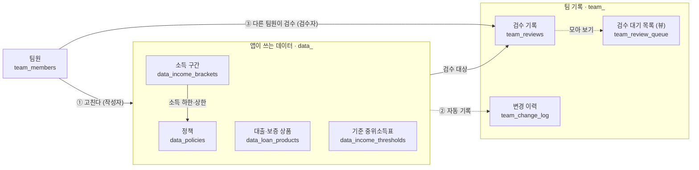
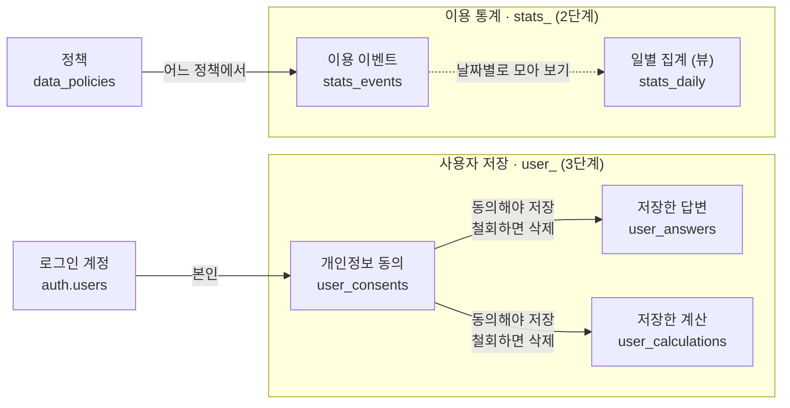

# Perky 데이터베이스 (Supabase)

> [!IMPORTANT]
> **이 README 는 옛 설계(2026-11-02, 표 11개)를 설명한다.** 2026-11-09 에 멘토 조언에 맞춰
> 핵심 5테이블로 다시 짰다 → [`docs/기획/2026-11-09-DB-재설계-5테이블.md`](../docs/기획/2026-11-09-DB-재설계-5테이블.md)
> - 새 설계 SQL: `supabase/redesign/20261110000000_perky_5tables.sql`
> - 새 설계 검사: `cd supabase/tests && node redesign.test.mjs` (50개)
> - 팀이 새 설계로 확정하면 `migrations/` 의 옛 파일 3개 · `seed.sql` · `build-seed.mjs` · `tests/db.test.mjs` 를 정리한다.
>   그 전까지 옛 파일과 새 파일을 **같이 적용하지 않는다** (충돌한다).

`apps/web/data/*.json` 을 Supabase(Postgres)로 옮기기 위한 테이블 설계다.
**사용자 화면은 지금처럼 정적 JSON 을 읽는다.** DB 는 팀이 정책을 고치고 검수하는
곳이고, 배포 전에 DB 에서 JSON 을 뽑아 앱에 넣는다.

## 파일

| 파일 | 내용 |
|---|---|
| `migrations/20261102120000_phase1_policy_data.sql` | **1단계** 정책 데이터 + 팀 검수 |
| `migrations/20261102120100_phase2_stats.sql` | **2단계** 익명 이용 통계 |
| `migrations/20261102120200_phase3_user_data.sql` | **3단계** 사용자 계정·저장 (선택 가입) |
| `seed.sql` | 현재 JSON 6개 정책·4개 상품·소득표를 그대로 옮긴 초기 데이터 |
| `build-seed.mjs` | JSON → `seed.sql` 생성기 (`node supabase/build-seed.mjs`) |
| `tests/db.test.mjs` | 규칙이 실제로 지켜지는지 확인하는 73개 검사 |

## 테이블 한눈에

### 1단계 — 정책 데이터와 팀 검수



### 2·3단계 — 이용 통계와 사용자 저장



상자 위쪽이 한글 이름, 아래쪽이 실제 테이블 이름이다. 실선은 다른 표를 가리키는 관계,
점선은 자동으로 채워지거나 모아 보는 관계다. 소득 구간 표는 검수 대상이 아니다.

### 목록

이름 앞부분이 용도다. Supabase Table Editor 는 이름순이라 용도별로 묶여 보인다.

| 묶음 | 이름 | 테이블 | 한 행 = | 원래 있던 곳 |
|---|---|---|---|---|
| **앱이 쓰는 데이터** | 소득 구간 | `data_income_brackets` | 1층 소득 선택지 하나 | `income-brackets.json` |
| | 기준 중위소득표 | `data_income_thresholds` | 한 해의 표 | `income-thresholds.json` |
| | 대출·보증 상품 | `data_loan_products` | 안내만 하는 상품 하나 | `loan-products.json` |
| | 정책 | `data_policies` | 현금성 주거 지원 정책 하나 | `policies.json` |
| **팀 기록** | 변경 이력 | `team_change_log` | 변경 한 번 (전·후 값, 누가, 왜) | git 이력 |
| | 팀원 | `team_members` | 팀원 한 명 | — |
| | 검수 대기 목록 *(뷰)* | `team_review_queue` | 데이터 하나의 현재 검수 상태 | — |
| | 검수 기록 | `team_reviews` | 데이터 하나의 **특정 버전**을 원문과 대조한 1회 | 각 JSON 의 `verifiedAt` |
| **이용 통계** (2단계) | 일별 집계 *(뷰)* | `stats_daily` | 날짜 × 이벤트 × 정책 | — |
| | 이용 이벤트 | `stats_events` | 익명 이벤트 하나 | — |
| **사용자 저장** (3단계) | 저장한 답변 | `user_answers` | 사용자 한 명의 마지막 1층 답변 | 브라우저 `localStorage` |
| | 저장한 계산 | `user_calculations` | 저장한 2층 계산 한 건 | — |
| | 개인정보 동의 | `user_consents` | 사용자 한 명의 동의 상태 | — |

### 칸 정리 규칙

- **모든 표와 칸에 한글 설명이 붙어 있다.** Table Editor 에서 표 이름 옆·칸 머리에 보인다.
- **data_ 표의 칸 순서는 같다:** `[식별] → [내용] → [관리 4칸]`
  - 식별 = `id` · `status` · `sort_order`
  - 관리 4칸 = `version` · `edited_at` · `edited_by` · `edit_note` — 항상 맨 뒤, 설명은 `[관리]` 로 시작
  - 관리 칸은 트리거가 채운다. **사람이 적는 것은 `edit_note`(고친 이유) 하나뿐이다.**
- **정해진 값만 받는 칸은 드롭다운이다.** `status`·`benefit_type`·`result`·`role` 같은 칸은
  선택지 타입(`opt_` 로 시작, 11개)이라 Table Editor 에서 목록으로 고른다. 오타를 넣으면
  `invalid input value for enum opt_benefit_type` 처럼 거부된다.
  - 값 추가: `alter type public.opt_benefit_type add value '새값';`
  - 값을 빼거나 이름을 바꾸는 것은 어렵다. 쓰는 행이 없는지 먼저 확인하고 팀과 정할 것
  - `opt_eligibility_input` 은 `lib/types.ts` 의 `EligibilityProfile` 키와 같아야 한다
- **에러에 규칙 이름이 한글로 나온다.** 예: `violates check constraint "나이_범위"`
- **함수 이름도 용도별이다:** `export_*` 앱용 JSON 내보내기 · `trg_*` 트리거 전용 ·
  `is_*` / `has_*` 권한 확인
- **권한 규칙 이름은 `동작: 누가`** 형식이다 (예: `읽기: 팀원`, `추가: 동의한 본인`)

`data_policies` 의 1층 판정 칸은 `discovery_` 로 시작한다 (JSON 의 `discovery` 블록).
`null` 의 뜻은 칸마다 다르니 칸 설명을 볼 것 — `lib/types.ts` 의 `PolicyDiscovery` 주석과 같다.

## 데이터가 흐르는 길

```
[지금]   apps/web/data/*.json ──build-seed.mjs──▶ seed.sql ──▶ Supabase   (처음 한 번)

[이후]   팀원이 Supabase 에서 수정 → 다른 팀원이 검수
           └─▶ export_policies() 등 4개 함수 ──▶ apps/web/data/*.json ──▶ npm test ──▶ 배포
```

내보내기 함수의 결과는 지금의 JSON 4개와 **값이 완전히 같다** (검사 [1]). 그래서 DB 로
옮겨도 앱 동작은 바뀌지 않는다. JSON 을 파일로 쓰는 스크립트는 아직 없다 — Supabase 연결
후 다음 작업이다. jsonb 는 키 순서를 바꾸므로 그 스크립트가 지금 파일과 같은 키 순서로
다시 정렬해 써야 git diff 가 깨끗하다.

## DB 가 강제하는 규칙

1. **틀린 값은 저장되지 않는다.** `policies.test.ts` 가 JSON 에 대해 검사하던 것을 제약으로
   옮겼다. 나이 하한 > 상한, 없는 `requiredInputs` 키, 일시금 정책에 계산 기준 누락,
   20자리가 아닌 온통청년 번호, 하한만 있는 소득 밴드, 가구원 수가 늘수록 줄어드는
   중위소득 등은 저장 단계에서 거부된다.
2. **내용을 고치면 `version` 이 오르고, 검수가 다시 필요해진다.** 그 전 버전에 대한 검수는
   `verifiedAt` 으로 나가지 않아 화면에 "아직 공고 원문과 대조하지 않았습니다"가 뜬다.
   `status`·`sort_order` 만 바꾸는 것은 내용 변경이 아니라 버전이 그대로다.
3. **고칠 때마다 `edit_note` 를 새로 적는다.** 안 적으면 수정이 거부된다.
4. **작성자 ≠ 검수자.** 현재 버전을 쓴 사람(`edited_by`)은 그 버전을 검수할 수 없다.
   검수 시각은 사람이 적지 않고 기록한 때로 자동으로 들어간다.
5. **기록은 고치거나 지울 수 없다.** `team_change_log` 와 `team_reviews` 는 관리자도 수정·삭제가
   막혀 있다. 정책도 지우지 않고 `status` 를 `archived` 로 바꾼다.
6. **검수의 마지막 결과를 따른다.** 같은 버전에 `confirmed` 다음 `needs_fix` 가 남으면
   `verifiedAt` 은 `null` 이다.

## 처음 적용하기

1. Supabase 연결을 인증한다 (Claude Code 에서는 `/mcp`).
2. `migrations/` 의 파일 3개를 이름순으로, 그다음 `seed.sql` 을 적용한다.
   Supabase 대시보드의 SQL Editor 에 붙여 넣거나, Supabase CLI 를 쓴다
   (`supabase link` 후 `supabase db push`, seed 는 SQL Editor 에서).
   **3단계 파일은 아래 "3단계 전에"를 먼저 읽을 것.**
3. 팀원이 각자 Supabase Auth 로 가입한 뒤, SQL Editor 에서 첫 admin 을 넣는다.

   ```sql
   insert into team_members (user_id, display_name, role)
   select id, '이름', 'admin' from auth.users where email = '팀원@이메일';
   ```

   그 뒤 팀원 추가는 같은 SQL 로 하거나, admin 계정으로 로그인한 API 호출로 한다
   (member 는 팀원을 추가할 수 없다).

## 팀원이 쓰는 법 (SQL 예시)

```sql
-- 검수할 것 보기
select * from team_review_queue where needs_review order by kind, item_key;

-- 정책 고치기 (edit_note 필수)
update data_policies
set monthly_cap = 200000,
    edit_note   = '2027년 공고 원문 기준 월 상한 확인 (https://...)'
where id = 'iksan-youth-rent-support';

-- 다른 팀원이 검수하기 (버전·검수자·시각·출처 URL 은 자동으로 채워진다)
insert into team_reviews (policy_id, result, memo)
values ('iksan-youth-rent-support', 'confirmed', '공고 2쪽 표와 일치');

-- 이력 보기
select changed_at, changed_by, edit_note, old_row->>'monthly_cap', new_row->>'monthly_cap'
from team_change_log where item_key = 'iksan-youth-rent-support' order by changed_at desc;
```

## 알아 둘 한계

- **Studio(대시보드 Table Editor)에서 고치면 로그인 정보가 없다.** 그때는 `edited_by` 칸에
  적힌 값을 작성자로 믿는다. 다른 사람이 쓴 행을 고칠 때 `edited_by` 를 본인 id 로 바꾸지
  않으면 작성자가 잘못 기록된다. 작성자 ≠ 검수자가 확실히 지켜지는 것은 로그인한 팀원이
  API 로 고칠 때다. 편집 화면을 따로 만들면 이 구멍이 닫힌다.
- **새 정책을 넣으면 `lib/policy-rules.ts` 에도 판정 규칙을 추가해야 한다.** DB 는 코드를
  검사할 수 없다. 규칙이 없으면 아무 조건도 보지 않고 '예상적용'이 된다. JSON 을 뽑은 뒤
  `npm test` 가 이것을 잡는다.
- **전세보증금반환보증 보증료 지원이 `data_policies` 와 `data_loan_products` 에 둘 다 있다.**
  JSON 에 있던 중복을 그대로 옮겼다 (`docs/기획/2026-09-02-전국화Phase1-확인목록.md` 6번).
  `data_loan_products` 쪽을 `archived` 로 내릴지 팀이 정한다.
- **seed 의 옛 검수 기록에는 검수자가 없다** (`imported = true`). 원래 JSON 에 검수자 이름이
  없었기 때문이다. 팀원은 이 표시를 붙일 수 없게 막아 두었다.
- **2단계 이벤트를 앱에서 보낼 때** 응답을 돌려받지 않는 방식으로 넣어야 한다
  (supabase-js 의 `.insert()` 뒤에 `.select()` 를 붙이지 않는다). 익명 사용자에게는 읽기
  권한이 없어서다. 표에 IP 는 남기지 않지만 Supabase API 로그에는 남는다 — 화면에
  익명 통계 수집 고지가 필요하다.
- **무료 플랜은 일정 기간 접속이 없으면 프로젝트가 일시 중지된다.** 앱은 DB 를 직접
  읽지 않으므로 사용자 화면은 멈추지 않지만, JSON 을 새로 뽑는 일은 막힌다.

## 3단계 전에

`20261102120200_phase3_user_data.sql` 은 표를 만들 뿐 아무것도 수집하지 않는다. 화면이 이 표를
쓰기 시작하면 "답변은 브라우저에만 둔다"(PRD F0-13, PRODUCT.md)는 약속이 바뀐다.
그 전에 개인정보 처리방침과 PRD 문구를 먼저 고친다. 표에 이미 들어 있는 장치는 이렇다.

- 동의(`user_consents`)가 없으면 저장할 수 없다
- 동의를 철회하면 저장한 답변·계산이 즉시 지워진다
- 계정을 지우면 전부 함께 지워진다
- 본인 행만 보인다. 팀원도 사용자 데이터를 볼 수 없다

## 검증

```bash
cd supabase/tests
npm install
npm test           # 73개 검사
SHOW=1 npm test    # 거부될 때 나오는 에러 문구까지
```

설치 없이 Node 안에서 도는 Postgres(PGlite)에 마이그레이션 3개와 seed 를 적용하고 확인한다.

- [0] 표 이름이 묶음 규칙을 따르는지, 모든 표·칸에 설명이 있는지, 관리 칸 순서가 같은지,
  정해진 값만 받는 칸이 모두 선택지 타입인지
- [1] 내보내기 결과가 현재 JSON 과 같은지
- [2]~[8] 틀린 값·권한 없는 접근이 거부되고, 버전·검수·동의 규칙이 지켜지는지

Supabase 의 `auth` 스키마와 역할(anon·authenticated·service_role)은 흉내 낸 것이라,
실제 Supabase 에 적용한 뒤 한 번 더 확인하는 것이 좋다.
